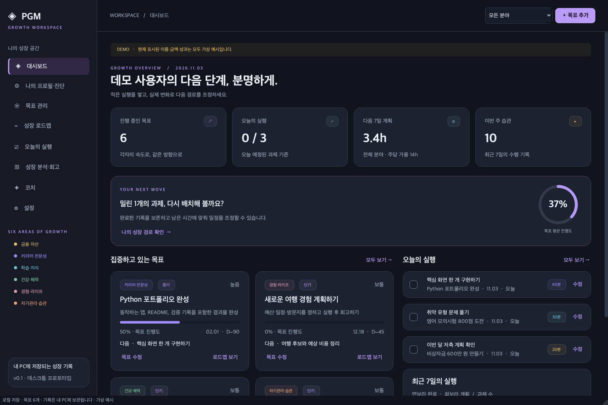

# PGM — 개인 성장 플랫폼

현재 상태를 기록하고, 목표까지의 경로를 설계·실행·수정하는 개인용 데스크톱 프로토타입입니다. Python, PySide6, SQLite를 사용하며 Windows와 macOS를 대상으로 합니다.

**프로토타입에서 할 수 있는 일**

- 6개 분야 관리: 금융·자산, 커리어·전문성, 학습·지식, 건강·체력, 경험·라이프스타일, 자기관리·습관
- 개인 프로필·가용 시간·자산 현황과 근거 유형별 현재 상태 기록
- 목표·기한·우선순위·완료 기준 관리
- 분야별 규칙을 이용한 로드맵 초안, 공유 가용 시간을 반영한 일정 배치·재계획
- 일일 과제, 반복 습관, 실행 기록, 분석과 회고
- 로컬 규칙 기반 코칭, 브라우저 자료 검색, 상담 요약 복사
- SQLite 자동 저장과 Windows·Mac 간 백업 내보내기·전체 복원

외부 AI API와 자동 웹 검색은 아직 연결하지 않았습니다. 코칭과 로드맵 초안은 프로그램의 규칙에 따른 제안이며, 객관적 역량 평가나 최적 경로를 보장하지 않습니다. 현재 값·근거·목표 진행도를 구분해서 표시합니다.

**바로 실행하기**

Python 3.10 이상이 필요하며 Python 3.12를 기본 개발 환경으로 사용합니다. 저장소 루트에서 실행하세요.

| 환경 | 실행 방법 |
|---|---|
| macOS | `launch_macos.command`를 더블클릭하거나 터미널에서 `./launch_macos.command` |
| Windows | `launch_windows.bat`를 더블클릭 |

실행기는 프로젝트의 `.venv`를 사용합니다. 가상환경이 없으면 생성하고, 필요한 PySide6가 없으면 `requirements.txt`를 설치합니다. 최초 설치에는 인터넷 연결이 필요합니다.

수동 설치·실행은 다음과 같습니다.

```bash
python3.12 -m venv .venv
# macOS
.venv/bin/python -m pip install -r requirements.txt
.venv/bin/python -m pgm
```

```bat
py -3.12 -m venv .venv
rem Windows
.venv\Scripts\python.exe -m pip install -r requirements.txt
.venv\Scripts\python.exe -m pgm
```

**가상 데이터로 둘러보기**

```bash
# 활성화된 가상환경에서 실행
python -m pgm --demo
```

`--demo`는 명백한 가상 예시를 사용합니다. `--data-dir`을 지정하지 않으면 일반 데이터와 분리된 데모 폴더를 사용합니다. 일반 실행은 운영체제의 사용자 앱 데이터 폴더에 저장하며, 설치 폴더와 분리됩니다.

별도 테스트 폴더를 사용하려면 `python -m pgm --data-dir "원하는 경로"`로 실행하세요. `--demo --data-dir "원하는 경로"`는 지정한 폴더를 데모 저장 위치로 사용하므로 개인 데이터 폴더와 구분하세요.

**백업과 제약 사항**

설정에서 `.pgmbackup` 파일을 내보낸 뒤 다른 기기에서 복원합니다. DB 스냅샷·첨부 파일·형식 정보가 포함된 **암호화하지 않은 ZIP**입니다. 두 기기에서 따로 수정한 데이터의 병합은 지원하지 않으며, 복원은 현재 데이터를 교체합니다. 복원 전 현재 데이터의 백업을 보관합니다.

알림은 앱 실행 중 지원합니다. 완전 종료·절전 상태의 알림, 금융기관·웨어러블 연동, 실시간 동기화, 외부 AI API·자동 자료 수집은 현재 범위에 포함되지 않습니다. 실제 개인 데이터, 로컬 DB, 백업, API 키는 Git에 포함하지 않습니다.

**개발·검증·실행 파일 제작**

```bash
python -m pip install -r requirements-dev.txt
python -m pytest -q
python -m pgm --demo --smoke-test
python scripts/build.py
```

GUI 없는 테스트 환경에서는 `QT_QPA_PLATFORM=offscreen`을 설정합니다. `python -m pgm --demo --screenshot "dashboard.png"`로 화면을 저장할 수 있습니다. 실행 파일은 PyInstaller의 폴더 형태로 제작하며, Windows와 macOS 각각에서 빌드·검증해야 합니다. 빌드 명령만 확인하려면 `python scripts/build.py --dry-run`을 사용하세요.

검증 결과(2026-11-03): Python 3.12.2 · PySide6 6.12.0 · macOS arm64에서 자동 테스트 **54개 및 하위 검증 8개 통과**, 실제 macOS 앱 빌드와 8개 메뉴 실행 확인. Windows 실행·빌드는 이 로컬 환경에서 검증하지 않았습니다.

자세한 사용 흐름과 제한은 [프로토타입 안내](docs/prototype-v0.1.md), 최초 설계 기준은 [요구사항 및 개발계획](docs/requirements-v0.1.md)에 있습니다.

**대시보드 미리보기 — 모든 수치는 가상 예시입니다.**


