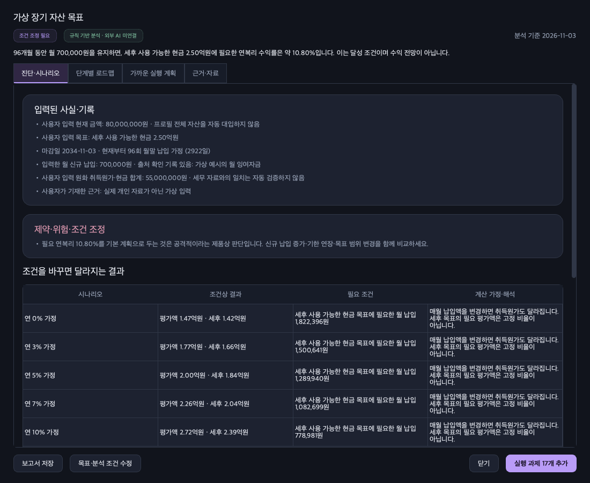

**목표 분석과 상세 로드맵 — v0.2 사용 안내**

목표를 저장하면 입력한 현재 상태, 완료 기준, 시간·비용 조건을 분석한 보고서가 열립니다. 목표 카드와 성장 로드맵에서도 상세 분석을 다시 확인할 수 있습니다. 계산 결과는 목표 달성 확률이나 검증된 역량 점수가 아닙니다.

**목표 설정에서 근거와 제약을 함께 기록합니다.**

- ‘현황·기준’: 현재 상황, 목표의 필수 기준, 현재 수준의 근거, 제약과 참고 URL을 입력합니다.
- ‘시간·비용’: 이미 완료한 시간을 제외한 남은 작업 예상 총시간, 이 목표에 배정할 주당 시간, 월 예상 비용을 기록합니다.
- ‘자산·세금’: 금융 분야에서 월 신규 납입액, 재원과 지속 가능성, 계좌 평가액 또는 세후 현금 목표, 세무상 원가와 과세 가정을 입력합니다.
- 모르는 수치는 ‘입력’을 선택하지 않은 채 둡니다. 화면의 ‘정보 미입력’과 사용자가 확인한 0을 구분합니다. 목표 표시 단위가 만원·억원이어도 자산·세금 탭의 납입액·원가·공제는 모두 원 단위입니다.

**보고서는 네 가지 탭으로 나뉩니다.**

| 탭 | 확인할 내용 |
|---|---|
| 진단·시나리오 | 입력된 사실과 근거, 부족한 정보, 시간·자금 조건을 바꾼 계산, 제약·위험과 가정 |
| 단계별 로드맵 | 분야별 중간 단계, 각 단계의 이유, 실행 항목과 완료 기준, 점검·수정 조건 |
| 가까운 실행 계획 | 현재 가용 시간과 기존 과제·습관을 고려해 배치한 실행 초안 |
| 근거·자료 | 저장된 공식 참고 자료와 확인일, 사용자가 제공한 미검증 URL |

장기 단계와 가까운 실행 과제를 구분합니다. 이후 단계는 시작 가능일을 보존하며, 현재 기간 안에서 실행할 과제만 검토·적용합니다. 기존 미완료 과제가 있으면 중복 초안을 추가하지 않고 재계획으로 조정합니다. 완료한 과제와 기존 기록은 보존합니다.

**금융 목표는 평가액과 세후 현금을 구분합니다.**

월 신규 납입액은 생활비·세금 차감 후 계좌 밖에서 들어오는 자금입니다. 기존 보유 자산의 매도대금이나 재투자한 배당을 신규 자금으로 중복 계산하지 않습니다. 납입액이 프로필의 수입−지출보다 크면 별도 신규 재원의 출처와 지속 기간을 확인하도록 표시합니다.

세후 계산에는 세무 자료에 따른 취득원가·현금 합계와 과세 조건 확인이 필요합니다. 화면의 평가손익만으로 원가를 추정하지 않습니다. 원가나 과세 가정이 없으면 세후 금액은 ‘정보 부족’으로 남깁니다. 납입액을 바꾸는 시나리오는 새 납입 원금에 따른 취득원가 변화도 반영합니다.

금액 시나리오는 원화 기준의 일정한 연복리와 월말 납입을 가정합니다. 세후 결과는 전체 자산을 동일 해외주식 과세 방식으로 취급하고 마지막 해 전량 청산한다고 단순화한 예시입니다. 중간 매매·배당 과세·인출·수수료·환전 비용은 포함하지 않습니다. 실제 채권·예금 등의 과세는 다를 수 있으며 장래 세법은 확정할 수 없습니다.

**분석을 확인한 다음 적용합니다.**

‘목표·분석 조건 수정’으로 입력을 보완하거나, ‘실행 과제 추가’로 화면에 미리 표시된 과제만 저장합니다. 적용하기 전 보고서를 닫으면 기존 과제는 바뀌지 않습니다. 보고서의 초기 예상 시간과 완료 기준은 실제 조건에 맞춰 과제 수정 화면에서 편집할 수 있습니다.

보고서 저장은 사용자가 ‘보고서 저장’을 눌러 위치를 선택했을 때만 수행합니다. 개인 분석 보고서와 실제 데이터는 Git 커밋 대상으로 사용하지 않습니다.

**현재 분석은 검토 가능한 규칙과 계산을 사용합니다.**

외부 생성형 AI API와 실시간 자료 검색·검증은 연결하지 않았습니다. 저장된 자료의 확인일은 매 실행 시 최신 법령이나 시험 기준을 확인했다는 뜻이 아닙니다. 사용자 제공 URL과 자기평가는 검증된 사실로 확정하지 않으며, 정보가 부족하면 필요한 확인 항목을 표시합니다.

v0.1 데이터와 백업은 계속 읽고 복원할 수 있습니다. 이전 목표의 새 분석 조건은 미입력 상태로 시작하며, 기존 완료 기록을 추정 정보로 채우지 않습니다. 백업은 기존과 같이 비암호화 ZIP이며 전체 복원 방식입니다.

아래 화면은 실제 개인 자산과 무관한 가상 입력 예시입니다.

